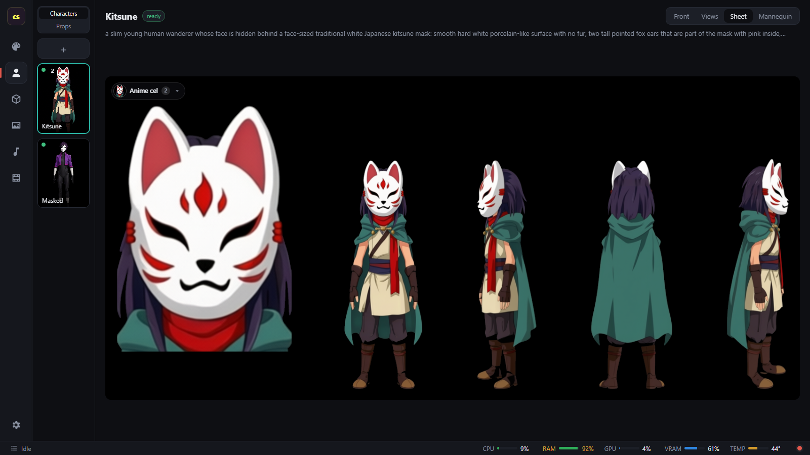
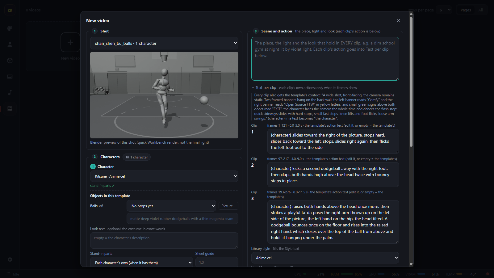

# cinestudio


**Direct a scene in Blender. Bring it to life with your own characters and open-weight AI models.**

cinestudio turns a Blender shot—its camera, motion and mannequin layout—into an AI-generated video. Reuse the same shot with different characters, backgrounds and styles, or create a new template to direct another scene.

Use the web app to build your project, or have an AI assistant drive the same workflow through MCP and the JSON CLI. Generation runs through ComfyUI on your own machine or a rented GPU.

> Work in progress for the Comfy **Open Source Higgsfield** challenge. See [AGENTS.md](AGENTS.md) for the detailed manual, agent instructions and tested tips.

## What you can make

- **Reusable styles:** Define a look with style words and an optional reference image. Apply it across your creative assets and videos.
- **Characters and props:** Generate or import characters, edit their images, create views and character sheets, and adjust a mannequin body to fit each character. Create or import props for a scene.
- **Blender templates:** Use a built-in shot or bring your own Blender template. The template controls the scene's camera, character placement and motion; reuse it with different assets. You can also make templates from a supplied video or create a dance template. See the [template guide](docs/TEMPLATE_GUIDE.md).
- **Backgrounds:** Create or import backplates and panoramas, including a background generated from a template's set.
- **Music and films:** Generate songs, use them with templates or videos, and assemble multiple scenes into a film.
- **Videos:** Combine a template, cast, background and style. Preview a shot, generate at final quality, and review your videos in the app. For longer shots, review individual clips, retake them and continue the run.
- **Advanced workflows:** Copy and edit the ComfyUI graphs used by the app.

## Make your first video

After setup, open the app with `python -m cinestudio app --open`. Use the tabs in the side rail:

1. **Styles:** Choose a style or create one to guide the look of your assets.
2. **Cast:** Create or import a character, choose and refine its front image, set its mannequin body, and generate its views and sheet. Finish the character so it is ready for video. Add props if your scene needs them.
3. **Templates:** Choose a built-in Blender shot, add your own, or create one from a supplied video. The template provides the scene's motion and camera; you can reuse it with another cast or look.
4. **Backgrounds:** Create or choose a background for the shot. A template's set can serve as a reference for a backplate.
5. **Music:** Optionally generate a song to use with a template or video.
6. **Video:** Select the template, character, background and other options, describe the scene, and generate a preview. Review it before generating at final quality. Your rendered videos are available in the Video workspace.

Generation jobs enter a shared queue, so longer steps may take time. The same template and assets can be used in another run without starting over.

### The app in action

Build and review a character sheet with front, side and back views:



Set up a video by combining a Blender shot, character and scene description, with controls for each clip:



## Setup and requirements

cinestudio needs Blender, ffmpeg, ComfyUI, the app's Python dependencies and model files. Run `python -m cinestudio doctor` to check the configured tools and models. For a rented Linux GPU, follow the installation and secure-access instructions in [docs/RUNPOD.md](docs/RUNPOD.md).

On an existing installation, open **Settings > Quick setup** in the app to choose a model tier and download the files. You can also use the CLI:

```sh
python -m cinestudio setup                  # prompts for tokens and a tier, then downloads
python -m cinestudio models status          # check what is needed and already installed
python -m cinestudio models download --detach
```

| Tier | Hardware | Model files |
| --- | --- | --- |
| `8gb` | 8 GB VRAM and 32 GB RAM; tested on an RTX 3070 | About 156 GB with every feature |
| `large` | 80 GB+ VRAM and about 120 GB RAM | About 225 GB |

These sizes are for model files; allow additional space for the runtime and your generated work. The default Blender video workflow uses the distilled LTX-2.5 model in both tiers. The full model is used for video-to-video workflows. See [docs/MODELS.md](docs/MODELS.md) for model choices, downloads and licensing.

A **Hugging Face token** with access to the gated LTX-2.5 files is required for a new install. A Comfy Cloud API key is optional and only needed for the paid cloud service; a Civitai API key is only needed for downloads that require it. Set or replace a token without putting its value on the command line:

```sh
python -m cinestudio settings token set hf
python -m cinestudio models verify             # check downloaded files by hash
python -m cinestudio settings models-dir PATH  # optional: use another models folder
```

Tokens are stored in git-ignored `.cinestudio/secrets.json` (owner-only on Linux). `HF_TOKEN`, `COMFY_API_KEY` and `CIVITAI_TOKEN` environment variables take precedence. The app and CLI do not display token values.

## The queue and ComfyUI

Character generation, videos, songs, templates and backgrounds share a first-in, first-out GPU queue. Jobs run in background processes, so closing or restarting the app does not itself stop them. View the queue in the app's side rail or use:

```sh
python -m cinestudio queue list
python -m cinestudio queue cancel character JOB_ID  # also supports video, song, template and lab jobs
```

A **no recent progress** notice does not necessarily mean a job has stopped; some model steps can be quiet for a long time. If a song's outcome cannot be confirmed, the queue can hold new work to prevent overlapping GPU jobs. See the queue recovery instructions in [AGENTS.md](AGENTS.md).

cinestudio can find an installed ComfyUI and start it hidden when needed. On smaller machines it may restart the engine it started when changing model families. It does not automatically restart a ComfyUI started by another program. If you share ComfyUI, avoid submitting other prompts to it while cinestudio is working: a separate prompt submitted between a queue check and a restart could still be interrupted.

```sh
python -m cinestudio comfy status
python -m cinestudio comfy start
python -m cinestudio comfy stop  # only an engine started by cinestudio, with an empty queue
```

Set `CINESTUDIO_AUTOSTART_COMFYUI=0` if you prefer to start ComfyUI yourself. `CINESTUDIO_RESTART=none` makes engine restarts manual; `CINESTUDIO_RESTART=manager-shared` permits a shared engine restart through ComfyUI-Manager.

## Drive the workflow with AI or code

The UI is optional. An AI assistant can use cinestudio's MCP server to manage styles and assets, create templates, submit videos, monitor the queue and review results. The same workflow is available through the JSON CLI. Long-running requests return a job or run ID for checking progress.

For example, add the MCP server to Claude Code (replace `<repo>` with your checkout path):

```sh
claude mcp add cinestudio -- "<repo>/.venv/Scripts/python.exe" -m cinestudio mcp
```

Or configure an MCP client directly:

```json
{
  "mcpServers": {
    "cinestudio": {
      "command": "<repo>/.venv/Scripts/python.exe",
      "args": ["-m", "cinestudio", "mcp"],
      "cwd": "<repo>"
    }
  }
}
```

These examples use the Windows virtual environment; on Linux use `<repo>/.venv/bin/python`. Read the MCP resource `cinestudio://agents`, or [AGENTS.md](AGENTS.md), for the tool guide, safe queue use and practical generation tips. Run `python -m cinestudio --help` for CLI commands.

## Models and credits

cinestudio combines Blender, ComfyUI and open-weight models including Z-Image for character fronts, Qwen-Image-Edit-2511 for edits and views, LTX-2.5 for video, and ACE-Step 1.5 for music. It ships no model files. Model licences and access requirements vary; see [docs/MODELS.md](docs/MODELS.md) and [docs/CREDITS.md](docs/CREDITS.md), including the terms for LTX-2.5.

## License

cinestudio's code is available under the [MIT License](LICENSE). Third-party software and model weights have their own licenses; see [credits](docs/CREDITS.md) and [model details](docs/MODELS.md).

## Project files

The app, CLI and MCP server live in `cinestudio/`; Blender scripts are in `bpy_jobs/` and `blender_lib/`; built-in templates and ComfyUI graphs are in `templates/` and `workflows/`. Installation tools are in `setup/`, with tests in `tests/` and further guides and research in `docs/`.

Your local characters, videos, templates, songs, backgrounds, tokens and runtime state live in the git-ignored `.cinestudio/` directory.
